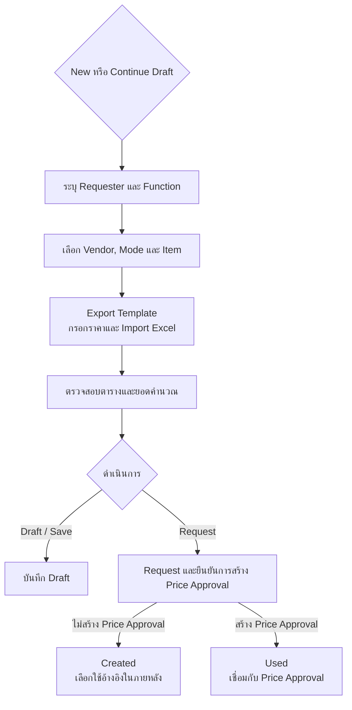
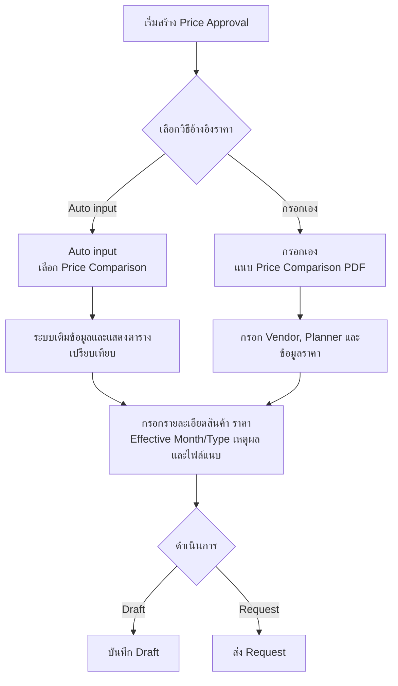
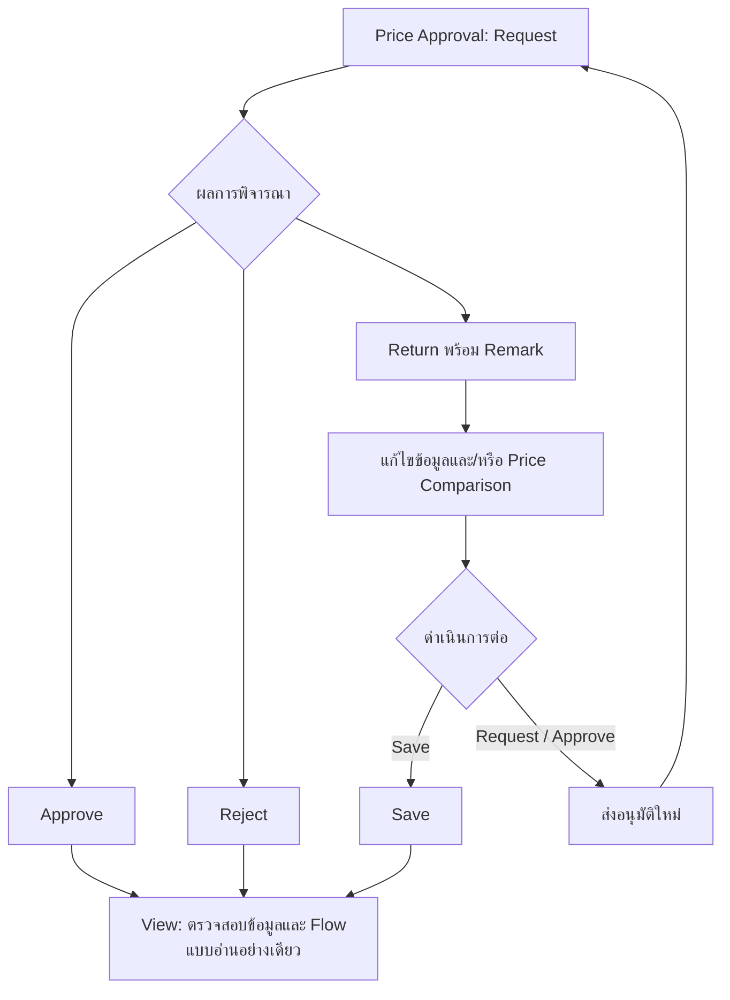

# PURFORM: Price Comparison and Price Approval Specification

## 1. Function Overview

เอกสารนี้สรุปการทำงานของ **Price Comparison (PRO-CPC / PRO-CPC)** และ **Price Approval (PRO-PRA)** จากคู่มือการใช้งานและโค้ดหน้าจอในระบบ

### 1.1 Price Comparison (PRO-CPC)

ใช้สร้างและจัดการข้อมูลเปรียบเทียบราคาสินค้าระหว่างราคาปัจจุบันกับราคาใหม่ ผู้ใช้ระบุ Requester และ Function เลือก Vendor, Mode และ Item นำเข้าข้อมูลราคาจาก Excel แล้วตรวจสอบผลการคำนวณก่อนบันทึกเป็น Draft หรือส่ง Request

ข้อมูล Price Comparison สามารถนำไปอ้างอิงใน Price Approval ได้ มีสถานะหลักดังนี้:

| สถานะ | ความหมาย |
| --- | --- |
| Draft | บันทึกร่างเพื่อกลับมาทำต่อ |
| Created | สร้าง Price Comparison แล้ว |
| Used | Price Comparison ถูกนำไปใช้อ้างอิงใน Price Approval |

### 1.2 Price Approval (PRO-PRA)

ใช้จัดทำคำขออนุมัติการเปลี่ยนแปลงราคา โดยผู้ใช้เลือกอ้างอิงข้อมูลจาก Price Comparison ที่มีอยู่ (Auto input) หรือกรอกข้อมูลและแนบไฟล์ Price Comparison PDF เอง จากนั้นกรอกรายละเอียดสินค้า ราคา ช่วงเวลาที่มีผล เหตุผล และเอกสารประกอบ ก่อนบันทึก Draft หรือส่ง Request เข้ากระบวนการอนุมัติ

ฟอร์มที่ถูก Return สามารถแก้ไขข้อมูลและไฟล์เดิมแล้ว Save หรือส่งกลับเข้าสู่กระบวนการอนุมัติได้ ส่วนหน้า View ใช้ตรวจสอบข้อมูลแบบอ่านอย่างเดียว

### 1.3 ผู้เกี่ยวข้อง

- **Inputer** — ผู้กรอกหรือบันทึกข้อมูลในฟอร์ม
- **Requester** — ผู้ร้องขอการเปรียบเทียบหรืออนุมัติราคา
- **Approver** — ผู้ดำเนินการกับ Price Approval ผ่านขั้นตอนอนุมัติ รวมถึง Approve, Reject หรือ Return ตามสิทธิ์และสถานะของฟอร์ม

## 2. Function Diagram

### Module 1: PRO-CPC — Price Comparison

### Module 2: PRO-PRA — Create Price Approval

### Module 3: PRO-PRA — Approval / Return / View

## 3. Feature Detail

### 3.1 PRO-CPC — สร้างและจัดการ Price Comparison

1. **New or Continue**
   - **New** เริ่มสร้างฟอร์มใหม่
   - **Draft** เลือกฟอร์ม Draft ที่ต้องการทำต่อ
2. **Input Data**
   - ระบุ Requester และเลือก Function จากรายการที่ระบบเปิดใช้งาน
   - Function ใช้กำหนดสูตร/ข้อมูลราคาที่นำมาเปรียบเทียบ
3. **Select Item Code**
   - เลือก Vendor และ Mode: **Add** หรือ **Edit**
   - เลือก Item จากตารางรายการของ Planner และระบบที่เกี่ยวข้อง
   - ส่งออกรายการ Item ที่เลือกเป็น Excel template สำหรับกรอกราคา
4. **Upload File**
   - รองรับไฟล์ Excel `.xlsx` และ `.xls`
   - ตรวจสอบข้อมูลในไฟล์ เช่น Function, Vendor และ Mode ต้องตรงกับค่าที่เลือก
   - Mode **Edit** ไม่ให้กรอก Old Item Compare; Mode **Add** หากระบุ Old Item Compare ต้องระบุครบทุกแถวและ Item ต้องมีในระบบ
   - Import & Map ข้อมูลลงตารางเพื่อให้ตรวจสอบและคำนวณผลรวม
5. **บันทึกและส่งคำขอ**
   - **Save/Draft** เก็บข้อมูลไว้ทำต่อ
   - **Request** แสดงหน้าต่างยืนยันก่อนส่ง และมีตัวเลือกสร้าง Price Approval Form
6. **ค้นหาและดูข้อมูล**
   - ค้นหาด้วย Requester, Planner, Status และ Vendor code โดยใช้เงื่อนไขหลายข้อร่วมกันได้
   - เปิด Price Comparison no. เพื่อดูรายละเอียด
   - ส่งออกตารางเปรียบเทียบเป็น Excel ได้

### 3.2 PRO-PRA — สร้าง Price Approval

1. **เลือกวิธีอ้างอิง Price Comparison**
   - **Auto input** เลือก Price Comparison ที่สัมพันธ์กับ Requester ระบบเติม Vendor, Vendor Name, Planner และยอด Present/New/Cost/Ratio พร้อมแสดงตารางเปรียบเทียบ
   - **กรอกข้อมูลเอง** แนบ Price Comparison PDF และกรอก Vendor, Planner และยอดราคาด้วยตนเอง
   - การเปลี่ยนโหมดจะเปลี่ยนชุดฟิลด์ที่ใช้และล้างข้อมูล/ตารางที่ไม่เกี่ยวข้องกับโหมดใหม่
2. **รายละเอียดสินค้า**
   - Vendor Code/Name, Planner Code, Material Code, Maker (Business route), Part Name, Model Name และ Job Item
   - เลือก PCS Committee และ Group
3. **ข้อมูลราคา**
   - Present Total Price, New Total Price, Cost Down/Cost Up Amount และ Ratio
   - ระบุ Effective Month และ Effective Type: PO issue basis, Delivery basis หรือ Others
   - เมื่อเลือก Others ให้ระบุรายละเอียดเพิ่มเติม
4. **เหตุผลและรายละเอียดประกอบ**
   - เลือกเหตุผลจากกลุ่ม Cost Down, Cost Up, Basic condition revise และ Estimate price
   - เหตุผลและฟิลด์ย่อยโหลดจากระบบ อาจมีตัวเลือกย่อยหรือช่องกรอกรายละเอียด
   - ระบุ Detail contents และแนบภาพประกอบได้
5. **ไฟล์แนบ**
   - Quotation price (E-Stamp) และ Additional document เป็นไฟล์ PDF
   - ไฟล์ภาพประกอบเป็นไฟล์ภาพ; ไฟล์แนบรองรับขนาดไม่เกิน 10 MB ต่อไฟล์
   - Quotation เป็นไฟล์ที่ต้องมี ยกเว้นเมื่อเลือก Estimate price รายการ “PO issue with temporary price” หรือเมื่อฟอร์ม Return มี Quotation เดิมอยู่แล้ว
6. **บันทึกและดำเนินการ**
   - Draft ต้องมี Requester
   - Request และการอนุมัติตรวจสอบฟิลด์ที่จำเป็น
   - การ Return ต้องมี Remark; Approver สามารถดำเนินการ Approve, Reject หรือ Return ตามปุ่มที่ระบบแสดง
   - ฟอร์ม Return โหลดข้อมูลเดิมกลับมาแก้ไขได้ หากเป็น Auto input สามารถเปิด Price Comparison ที่เชื่อมอยู่เพื่อแก้ไข และข้อมูลที่บันทึกจะ Sync กลับมายัง Price Approval

### 3.3 PRO-PRA — ดูฟอร์ม

หน้า View แสดงข้อมูลเอกสารและ Price Comparison, รายละเอียดสินค้า, ข้อมูลราคา, เหตุผล, Detail contents, ไฟล์แนบ และข้อมูล Flow (หากมี) โดยไม่อนุญาตให้แก้ไขข้อมูลจากหน้านี้

## 4. Screen Layout

### 4.1 PRO-CPC — Create

- หน้าแบ่งเป็นสองส่วน: แผงข้อมูล Inputer/Requester และรายละเอียดฟอร์มด้านซ้าย; พื้นที่ทำงานและ Step navigation ด้านขวา
- ขั้นตอนบนหน้าเรียงตามลำดับ:
  1. New or Continue
  2. Choose Pending Items (แสดงเมื่อเลือก Draft)
  3. Input Data
  4. Select Item Code
  5. Upload File
- **Select Item Code** มี Vendor dropdown, ตัวเลือก Add/Edit และตาราง Item
- **Upload File** มีช่องเลือกไฟล์ Excel และตารางเปรียบเทียบราคาที่เลื่อนได้ พร้อมปุ่ม Price Compare Export
- ปุ่ม Back/Next ใช้เลื่อนขั้นตอน; ปุ่ม Draft/Save/Request แสดงตามสถานะการสร้างหรือการแก้ไข

ตัวอย่างหน้าจอแต่ละขั้นตอน:

**New or Continue**
<FancyLightboxImage src="/image/purform/pur-cpc/create/step1.png"/>

**Choose Pending Items**
<FancyLightboxImage src="/image/purform/pur-cpc/create/step3-draft.png"/>

**Input Data**
<FancyLightboxImage src="/image/purform/pur-cpc/create/step2-new.png"/>

**Select Item Code**
<FancyLightboxImage src="/image/purform/pur-cpc/create/step4.png"/>

**Upload File**
<FancyLightboxImage src="/image/purform/pur-cpc/create/step5.png"/>

### 4.2 PRO-CPC — Search/View

- หน้า Search วางฟิลด์ Requester, Planner, Status และ Vendor code ไว้เหนือปุ่ม Search และตารางผลลัพธ์
- ตารางผลลัพธ์แสดงเลขที่ฟอร์ม, Input by, Request by, Function, Planner, Mode, Vendor, ยอด Present/New/Difference, Ratio, Request Date และ Status
- หน้า View แสดงข้อมูลผู้กรอก/ผู้ขอและตารางเปรียบเทียบราคา

**เงื่อนไขการค้นหา**
<FancyLightboxImage src="/image/purform/pur-cpc/search/before-search.png"/>

**ผลการค้นหา**
<FancyLightboxImage src="/image/purform/pur-cpc/search/after-search.png"/>

### 4.3 PRO-PRA — Create/Return

หน้าฟอร์มหลักเป็นคอลัมน์เดียว แบ่งเป็นส่วนตามลำดับ:

1. **ข้อมูลเอกสาร** — โหมด, Inputer, Requester และแหล่งอ้างอิง Price Comparison (เลขที่ฟอร์มหรือไฟล์ PDF) พร้อมตาราง/ตัวอย่าง PDF
2. **รายละเอียดสินค้า (New Item)** — Vendor, Planner, Material, Maker, Part, Model, Job Item, PCS Committee และ Group
3. **ข้อมูลราคา** — ยอดราคาและส่วนต่าง, Effective Month และ Effective Type
4. **เหตุผลการเปลี่ยนแปลง** — 4 กลุ่มเหตุผล, Detail contents และส่วนแนบภาพ
5. **ไฟล์แนบ** — Quotation price และ Additional document
6. **หมายเหตุ** — คำแนะนำสำหรับรายละเอียดก่อน/หลังการเปลี่ยนแปลงและเงื่อนไขการอนุมัติ

แผงปุ่ม Request/Action อยู่ท้ายฟอร์ม และเปลี่ยนตามโหมด/สถานะ/สิทธิ์ เช่น Draft, Save, Request, Approve, Reject, Return หรือ Back

**ตัวอย่างหน้า Create**

ข้อมูลเอกสาร:
<FancyLightboxImage src="/image/purform/pur-pra/create/detail.png"/>

รายละเอียดสินค้า:
<FancyLightboxImage src="/image/purform/pur-pra/create/item-detail.png"/>

ข้อมูลราคา:
<FancyLightboxImage src="/image/purform/pur-pra/create/price.png"/>

เหตุผลการเปลี่ยนแปลง:
<FancyLightboxImage src="/image/purform/pur-pra/create/reason1.png"/>
<FancyLightboxImage src="/image/purform/pur-pra/create/reason2.png"/>

ไฟล์แนบและหมายเหตุ:
<FancyLightboxImage src="/image/purform/pur-pra/create/attachment.png"/>

ปุ่มดำเนินการ:
<FancyLightboxImage src="/image/purform/pur-pra/create/request.png"/>

**ตัวอย่างหน้า Return/แก้ไข**

ข้อมูลเอกสารและข้อมูล Price Comparison ที่อ้างอิง:
<FancyLightboxImage src="/image/purform/pur-pra/return/detail.png"/>
<FancyLightboxImage src="/image/purform/pur-pra/return/edit-price-comp.png"/>
<FancyLightboxImage src="/image/purform/pur-pra/return/edit-pdf.png"/>

รายละเอียดสินค้าและข้อมูลราคา:
<FancyLightboxImage src="/image/purform/pur-pra/return/item-detail.png"/>
<FancyLightboxImage src="/image/purform/pur-pra/return/price.png"/>

เหตุผลการเปลี่ยนแปลง:
<FancyLightboxImage src="/image/purform/pur-pra/return/reason1.png"/>
<FancyLightboxImage src="/image/purform/pur-pra/return/reason2.png"/>

ไฟล์แนบและปุ่มดำเนินการ:
<FancyLightboxImage src="/image/purform/pur-pra/return/attachment.png"/>
<FancyLightboxImage src="/image/purform/pur-pra/return/action.png"/>

### 4.4 PRO-PRA — View

หน้า View ใช้รูปแบบส่วนข้อมูลตามลำดับเดียวกับ Create แต่แสดงค่าเป็นข้อความอ่านอย่างเดียว มีตารางหรือ PDF ของ Price Comparison, รายการไฟล์แนบ และ Flow ด้านล่างเมื่อมีข้อมูล

ข้อมูลเอกสารและ Price Comparison:
<FancyLightboxImage src="/image/purform/pur-pra/view/detail1.png"/>
<FancyLightboxImage src="/image/purform/pur-pra/view/detail2.png"/>

รายละเอียดสินค้าและข้อมูลราคา:
<FancyLightboxImage src="/image/purform/pur-pra/view/item.png"/>
<FancyLightboxImage src="/image/purform/pur-pra/view/price.png"/>

เหตุผลการเปลี่ยนแปลง:
<FancyLightboxImage src="/image/purform/pur-pra/view/reason1.png"/>
<FancyLightboxImage src="/image/purform/pur-pra/view/reason2.png"/>

ไฟล์แนบและ Flow:
<FancyLightboxImage src="/image/purform/pur-pra/view/attachment.png"/>
<FancyLightboxImage src="/image/purform/pur-pra/view/flow.png"/>