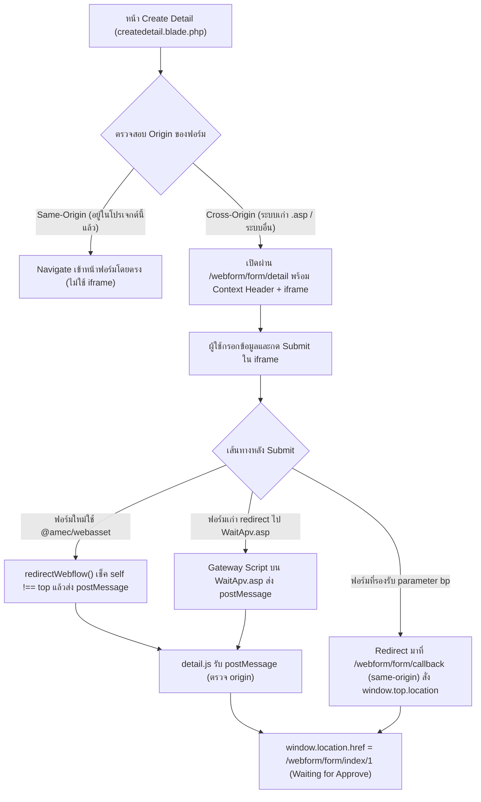

# แผนการปรับปรุง UX หน้า Create Detail (`iframe`) และการ Redirect กลับหน้า Waiting for Approve

## 1. สรุปปัญหาและสาเหตุที่พบในโค้ดปัจจุบัน

| ปัญหา | สาเหตุหลักในโค้ดปัจจุบัน | ไฟล์ที่เกี่ยวข้อง |
| :--- | :--- | :--- |
| **UX ไม่เป็นอันเดียวกับโปรเจกต์** | 1. ทุกฟอร์มถูกส่งผ่าน `/webform/form/detail` (`iframe`) แม้จะเป็นฟอร์มที่อยู่ในโปรเจกต์นี้แล้ว<br>2. หน้า `detail.blade.php` ไม่มี Context Header / ปุ่ม Back / ปุ่มเปิดแท็บใหม่<br>3. ใช้ `h-screen overflow-hidden` และไม่มี `#frame-container` ตามที่ `detail.js` อ้างถึง ทำให้เกิด scrollbar ซ้อนหรือเนื้อหาถูกตัด โดยเฉพาะกรณี cross-origin | `assets/script/form/create.js`<br>`application/views/form/detail.blade.php`<br>`assets/script/form/detail.js` |
| **Submit แล้วเด้งกลับหน้า Waiting for Approve ของโปรเจกต์นี้ได้ยาก** | 1. `redirectWebflow()` ใน `@amec/webasset` สั่ง `window.location = ".../WaitApv.asp"` ทำให้เปลี่ยนหน้าแค่ **ภายใน iframe**<br>2. ฟอร์มเก่า (`.asp`) ส่วนใหญ่ hardcode redirect ไป `WaitApv.asp` ซึ่งอยู่คนละ origin ทำให้หน้าแม่ไม่สามารถอ่าน `iframe.contentWindow.location.href` ได้ (ติด Same-Origin Policy)<br>3. `create.js` ส่ง `bp=${document.URL}` (หน้า `createdetail`) ไม่ใช่ callback URL สำหรับเด้งออกจาก iframe | `node_modules/@amec/webasset/src/js/_form.js`<br>`assets/script/form/create.js`<br>`assets/script/form/detail.js`<br>`application/controllers/webform/form.php` |

---

## 2. ภาพรวมการทำงานหลังปรับปรุง



---

## 3. แผนการดำเนินงาน (Step-by-Step)

### Phase 1: ปรับปรุงภายในโปรเจกต์นี้ (`form`)

#### 1.1 Smart Routing และปรับ `bp` ใน `assets/script/form/create.js`
- ตรวจสอบว่า URL เป้าหมายเป็น **same-origin** หรือไม่:
  - ถ้าเป็น same-origin (อยู่ในโปรเจกต์นี้แล้ว) ให้ `window.location.href = target` โดยตรง ไม่ต้องครอบด้วย `/webform/form/detail`
  - ถ้าเป็น cross-origin ค่อยเปิดผ่าน `/webform/form/detail?data=...&name=...&code=...` (ส่งชื่อ/รหัสฟอร์มไปแสดงบน Context Bar ด้วย)
- เปลี่ยนค่า `bp` จาก `document.URL` เป็น Callback URL ของโปรเจกต์นี้:
  ```js
  const bp = encodeURIComponent(`${process.env.APP_ENV}/webform/form/callback?to=waitapprove`);
  ```
- ตัวอย่างการเช็ค same-origin ใน `openFormDetail`:
  ```js
  let target = url;
  if (target.includes('index.asp')) {
      target = `https://webflow.mitsubishielevatorasia.co.th/${target}`;
  }

  const targetUrlObj = new URL(target, window.location.origin);
  const isSameOrigin = targetUrlObj.origin === window.location.origin;

  const destination = isSameOrigin
      ? targetUrlObj.href
      : `${process.env.APP_ENV}/webform/form/detail?data=${encodeURIComponent(targetUrlObj.href)}&code=${encodeURIComponent(formCode)}&name=${encodeURIComponent(formName)}`;

  saveRecentCreatedForm({
      code: formCode,
      name: formName,
      desc: formDesc,
      link: destination,
      group: $('#deptid').val(),
  });
  window.location.href = destination;
  ```

#### 1.2 เพิ่ม Callback Endpoint ใน `application/controllers/webform/form.php`
- อัปเดต `detail()` ให้รับ `code` และ `name` ไปแสดงที่ header ของ `detail.blade.php`
- เพิ่ม method `callback()` เพื่อรองรับฟอร์มที่ redirect กลับมาทาง parameter `bp`:
  ```php
  public function detail(){
      $target = $_GET['data'] ?? '';
      $title  = $_GET['title'] ?? 'nav-form-create';
      $code   = $_GET['code'] ?? '';
      $name   = $_GET['name'] ?? '';
      $this->views('form/detail', array(
          'target' => $target,
          'title'  => $title,
          'code'   => $code,
          'name'   => $name,
      ));
  }

  public function callback(){
      $to = $_GET['to'] ?? 'waitapprove';
      $redirectUrl = base_url('webform/form/index/1'); // Waiting for Approve
      if ($to === 'draft') {
          $redirectUrl = base_url('webform/form/index/0');
      }
      echo '<!DOCTYPE html><html><head><meta charset="utf-8"></head><body><script>';
      echo 'window.top.location.href = ' . json_encode($redirectUrl) . ';';
      echo '</script></body></html>';
  }
  ```

#### 1.3 ปรับ UI Wrapper ใน `application/views/form/detail.blade.php`
- เพิ่ม **Compact Context Bar** ด้านบน `iframe` ให้ดีไซน์สอดคล้องกับ `createdetail.blade.php`:
  - แสดง Badge รหัสฟอร์ม (`$code`) และชื่อฟอร์ม (`$name`)
  - ปุ่ม **Back** (กลับหน้าก่อนหน้า)
  - ปุ่ม **Waiting for Approve** (`base_url('webform/form/index/1')`) เป็นทางลัดให้ผู้ใช้กดออกได้เสมอ
  - ปุ่ม **Open in New Tab** (`target="_blank"`) เผื่อกรณีฟอร์มเก่าแสดงผลใน iframe ไม่สมบูรณ์
- แก้ layout container ให้มี `id="frame-container"` และใช้ `h-[calc(100vh-140px)]` (ปรับตามความสูงจริงของ navbar/header) แทน `h-screen overflow-hidden` เพื่อไม่ให้เกิด double scrollbar

#### 1.4 เพิ่ม `postMessage` Listener ใน `assets/script/form/detail.js`
- ดักฟัง event `message` จาก `iframe` พร้อม whitelist `allowedOrigins` เพื่อความปลอดภัย:
  ```js
  const ALLOWED_ORIGINS = [
      window.location.origin,
      'https://webflow.mitsubishielevatorasia.co.th',
      'http://webflow.mitsubishielevatorasia.co.th',
  ];

  window.addEventListener('message', (event) => {
      if (!ALLOWED_ORIGINS.includes(event.origin)) return;

      const data = event.data;
      if (!data || typeof data !== 'object') return;

      // 1) Redirect กลับไปหน้า Waiting for Approve
      if (data.type === 'WEBFLOW_REDIRECT') {
          const target = data.target || 'waitapprove';
          if (target === 'waitapprove') {
              window.location.href = `${process.env.APP_ENV}/webform/form/index/1`;
          } else if (data.url) {
              window.location.href = data.url;
          }
          return;
      }

      // 2) ปรับความสูง iframe ข้าม origin (กรณีปลายทางส่งมา)
      if (data.type === 'WEBFLOW_RESIZE' && Number(data.height) > 0) {
          const iframe = document.getElementById('my-iframe');
          if (iframe) {
              iframe.style.height = `${Number(data.height)}px`;
              $('#frame-container').css('height', `${Number(data.height)}px`);
          }
      }
  });
  ```

---

### Phase 2: ปรับปรุง 2 จุดนอกโปรเจกต์ (แก้ครั้งเดียว ครอบคลุมทุกฟอร์ม)

#### 2.1 แก้ `redirectWebflow()` ใน package `@amec/webasset`
ไฟล์: `src/js/_form.js`
```js
export function redirectWebflow() {
    // กรณีถูกเปิดใน iframe ของ Webflow Portal ใหม่
    if (window.self !== window.top) {
        window.parent.postMessage(
            { type: 'WEBFLOW_REDIRECT', target: 'waitapprove' },
            '*'
        );
        return;
    }

    // Fallback กรณีเปิดฟอร์มโดยตรง
    const path = window.location.host.includes('amecwebtest')
        ? 'formtest'
        : 'form';
    logtest('path webflow', path);
    const protocol = window.location.protocol;
    const redirectUrl = `${protocol}//webflow.mitsubishielevatorasia.co.th/${path}/workflow/WaitApv.asp`;
    window.location = redirectUrl;
}
```
> หมายเหตุ: หากต้องการเข้มงวดเรื่อง security สามารถเปลี่ยน `'*'` เป็น origin ของ portal หรือเช็ค `document.referrer` ก่อนส่งได้

#### 2.2 เพิ่ม Gateway Script บนสุดของ `WaitApv.asp` (ฝั่งระบบเก่า)
วางไว้ใน `<head>` หรือบรรทัดบนสุดของ `WaitApv.asp` (ทั้งฝั่ง `form` และ `formtest`):
```html
<script>
(function () {
    if (window.self !== window.top) {
        window.parent.postMessage(
            { type: 'WEBFLOW_REDIRECT', target: 'waitapprove' },
            '*'
        );
    }
})();
</script>
```
**ผลลัพธ์:** ฟอร์มเก่าทั้งหมดที่ submit แล้ววิ่งไป `WaitApv.asp` จะสั่งให้หน้าแม่เด้งกลับ `/webform/form/index/1` ทันที โดยไม่ต้องไปไล่แก้โค้ดฟอร์มเก่าทีละไฟล์

---

### Phase 3: การปรับแต่งเพิ่มเติม (Optional - ทำทีหลังได้)

- **ซ่อนเมนูซ้อนด้วย `&embed=1`**: ส่ง query param `&embed=1` ไปกับ URL ของ iframe และให้ระบบปลายทาง (ที่แก้โค้ดได้) ซ่อน sidebar/navbar ของตัวเองเมื่อพบ `embed=1`
- **Auto-resize ข้าม origin**: ให้ระบบปลายทาง (ที่แก้โค้ดได้) ติด `ResizeObserver` แล้วยิง `window.parent.postMessage({ type: 'WEBFLOW_RESIZE', height: document.documentElement.scrollHeight }, '*')` กลับมาที่ `detail.js`

---

## 4. Checklist สำหรับทดสอบที่เครื่องที่ทำงาน

- [ ] **Same-Origin Form**: กดเปิดฟอร์มที่อยู่ในโปรเจกต์นี้จากหน้า `createdetail` → ต้องเปิดหน้าฟอร์มตรงๆ ไม่มี `iframe` ครอบ
- [ ] **Cross-Origin Form (UI)**: กดเปิดฟอร์มระบบเก่า (`.asp`) → เห็น Context Bar ด้านบน, ปุ่ม Back, ปุ่ม Waiting for Approve, ปุ่ม Open in New Tab และไม่มี scrollbar ซ้อนจนใช้งานลำบาก
- [ ] **Submit ฟอร์มใหม่ (`@amec/webasset`)**: กด Submit ในฟอร์มที่เปิดผ่าน iframe → หน้าหลักต้องเด้งกลับไป `/webform/form/index/1` (Waiting for Approve) ไม่ค้างอยู่ใน iframe
- [ ] **Submit ฟอร์มเก่า (`.asp`)**: กด Submit → iframe วิ่งไป `WaitApv.asp` → Gateway Script ทำงาน → หน้าหลักเด้งกลับ `/webform/form/index/1`
- [ ] **Submit ฟอร์มที่ใช้ `bp`**: กด Submit → วิ่งกลับมาที่ `/webform/form/callback` → หน้าหลักเด้งกลับ `/webform/form/index/1`
- [ ] **เปิดฟอร์มตรง (นอก iframe)**: ทดสอบเปิดฟอร์มตรงๆ ไม่ผ่าน portal → `redirectWebflow()` และ `WaitApv.asp` ต้องยังทำงานได้ตามปกติไม่พัง
