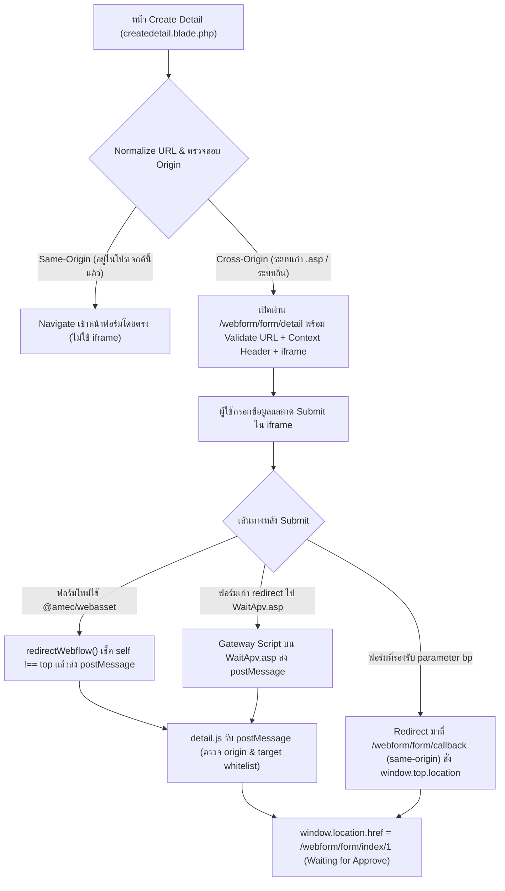

# แผนการปรับปรุง UX หน้า Create Detail (`iframe`) และการ Redirect กลับหน้า Waiting for Approve

## 1. สรุปปัญหาและสาเหตุที่พบในโค้ดปัจจุบัน

| ปัญหา                                                                | สาเหตุหลักในโค้ดปัจจุบัน                                                                                                                                                                                                                                                                                                                                                                                                                                                                                         | ไฟล์ที่เกี่ยวข้อง                                                                                                                                               |
| :------------------------------------------------------------------- | :--------------------------------------------------------------------------------------------------------------------------------------------------------------------------------------------------------------------------------------------------------------------------------------------------------------------------------------------------------------------------------------------------------------------------------------------------------------------------------------------------------------- | :-------------------------------------------------------------------------------------------------------------------------------------------------------------- |
| **UX ไม่เป็นอันเดียวกับโปรเจกต์**                                    | 1. ทุกฟอร์มถูกส่งผ่าน `/webform/form/detail` (`iframe`) แม้จะเป็นฟอร์มที่อยู่ในโปรเจกต์นี้แล้ว<br>2. หน้า `detail.blade.php` ไม่มี Context Header / ปุ่ม Back / ปุ่มเปิดแท็บใหม่<br>3. ใช้ `h-screen overflow-hidden` และไม่มี `#frame-container` ตามที่ `detail.js` อ้างถึง ทำให้เกิด scrollbar ซ้อนหรือเนื้อหาถูกตัด โดยเฉพาะกรณี cross-origin                                                                                                                                                                 | `assets/script/form/create.js`<br>`application/views/form/detail.blade.php`<br>`assets/script/form/detail.js`                                                   |
| **Submit แล้วเด้งกลับหน้า Waiting for Approve ของโปรเจกต์นี้ได้ยาก** | 1. `redirectWebflow()` ใน `@amec/webasset` สั่ง `window.location = ".../WaitApv.asp"` ทำให้เปลี่ยนหน้าแค่ **ภายใน iframe**<br>2. ฟอร์มเก่า (`.asp`) ส่วนใหญ่ hardcode redirect ไป `WaitApv.asp` ซึ่งอยู่คนละ origin ทำให้หน้าแม่ไม่สามารถอ่าน `iframe.contentWindow.location.href` ได้ (ติด Same-Origin Policy)<br>3. `create.js` ส่ง `bp=${document.URL}` (หน้า `createdetail`) ไม่ใช่ callback URL สำหรับเด้งออกจาก iframe                                                                                     | `node_modules/@amec/webasset/src/js/_form.js`<br>`assets/script/form/create.js`<br>`assets/script/form/detail.js`<br>`application/controllers/webform/form.php` |
| **บั๊กแฝงและความปลอดภัยในหน้า `detail`**                             | 1. `form::detail()` นำ `$_GET['data']` ไปใส่ `iframe src` ตรงๆ โดยไม่ validate scheme/host (เสี่ยง Open Redirect / `javascript:` URL)<br>2. `detail.js` ผูก `iframe.load` หลัง `await initApp()` ทำให้เกิด race condition ถ้า iframe โหลดเสร็จก่อนจะค้างหน้าโหลดเต็ม 15 วินาที<br>3. `detail.js` อ่าน `$('#user-login').attr('name')` แทน `empname` และ `await setPerformance()` บล็อกการซ่อน loader<br>4. `localStorage` (`recent-created-forms`) เก็บลิงก์แบบเดิมไว้ ทำให้คลิกลิงก์เก่ายังวิ่งเข้า iframe เดิม | `application/controllers/webform/form.php`<br>`assets/script/form/detail.js`<br>`assets/script/form/create.js`<br>`assets/script/form/data.js`                  |

### ขอบเขตงาน (Scope)

- **ใน Scope (Phase 1 & 2):** หน้า Create Form (`create.js` / `createdetail`), หน้า Form List (`index.js` — Waiting for Approve / Draft / อื่นๆ), หน้า Detail Wrapper (`form.php` / `detail.blade.php` / `detail.js`), Callback endpoint, Gateway Script บน `WaitApv.asp`, และ `redirectWebflow()` ใน `@amec/webasset`
- **หลักการ Routing:** ทุกฟอร์ม (ทั้ง same-origin ในโปรเจกต์นี้และ cross-origin `.asp`) เปิดผ่าน `/webform/form/detail` เพื่อคง Sidebar + Context Bar ของพอร์ทัลไว้เสมอ (เพราะ template ของฟอร์มลูกไม่มี sidebar) โดยฟอร์มที่เป็น same-origin จะได้รับ auto-resize ความสูงตามเนื้อหาอัตโนมัติจาก `ResizeObserver` ใน `detail.js`

---

## 2. ภาพรวมการทำงานหลังปรับปรุง



---

## 3. แผนการดำเนินงาน (Step-by-Step)

### Phase 1: ปรับปรุงภายในโปรเจกต์นี้ (`form`)

#### 1.1 Smart Routing, URL Normalization และ `bp` ใน `assets/script/form/create.js`

- สร้าง helper `normalizeTargetUrl(rawUrl)` ให้ครอบคลุมทุกกรณี (สอดคล้องกับ `assets/script/form/index.js`):
    - ถ้าไม่ขึ้นต้นด้วย `http://` หรือ `https://` ให้ถือว่าเป็น path ของระบบเก่า และต่อด้วย `https://webflow.mitsubishielevatorasia.co.th/` โดยตัด `/` นำหน้าซ้ำออกไม่ให้เกิด `//`
    - ถ้าเป็น `http://` บนโดเมนที่รองรับ HTTPS (หรือเมื่อพอร์ทัลรันบน `https:`) ให้อัปเกรดเป็น `https://` เพื่อลดปัญหา Mixed Content และ protocol mismatch
- เปลี่ยนค่า `bp` ใน `createFormTable()` จาก `document.URL` เป็น Callback URL ของโปรเจกต์นี้:
    ```js
    const bp = encodeURIComponent(
        `${process.env.APP_ENV}/webform/form/callback?to=waitapprove`,
    );
    ```
    > หมายเหตุ: กรณี same-origin (ไม่ได้เปิดใน iframe) `window.top.location.href` ใน `callback()` ยังทำงานได้ปกติเหมือน `window.location.href`
- ตรวจสอบ same-origin ใน `openFormDetail`:

    ```js
    function normalizeTargetUrl(rawUrl) {
        let target = String(rawUrl || '').trim();
        if (!target) return '';

        if (!/^https?:\/\//i.test(target)) {
            const cleanPath = target.replace(/^\/+/, '');
            target = `https://webflow.mitsubishielevatorasia.co.th/${cleanPath}`;
        } else if (
            window.location.protocol === 'https:' &&
            target.startsWith('http://')
        ) {
            target = target.replace(/^http:\/\//i, 'https://');
        }
        return target;
    }

    function buildFormDestination({ formCode, formName, url }) {
        const normalized = normalizeTargetUrl(url);
        const targetUrlObj = new URL(normalized, window.location.origin);
        const isSameOrigin = targetUrlObj.origin === window.location.origin;

        return isSameOrigin
            ? targetUrlObj.href
            : `${process.env.APP_ENV}/webform/form/detail?data=${encodeURIComponent(targetUrlObj.href)}&code=${encodeURIComponent(formCode)}&name=${encodeURIComponent(formName)}`;
    }
    ```

- **จัดการข้อมูลเก่าใน `localStorage` (`recent-created-forms`):**
    - เก็บ `targetUrl` (URL ดิบที่ normalize แล้ว) คู่กับ `code`, `name`, `desc`, `group` และคำนวณ `destination` ใหม่ตอน render/คลิก
    - สำหรับรายการเก่าที่ค้างอยู่ใน `localStorage` (มีแค่ `link` แบบ `/webform/form/detail?data=...` ที่ไม่มี `code`/`name`) ให้ดึง query `data` ออกมา normalize ใหม่ใน `getRecentCreatedForms()` เพื่อไม่ให้ผู้ใช้คลิกเจอหน้า wrapper เก่า

#### 1.2 Validate URL ใน `detail()` และเพิ่ม `callback()` ใน `application/controllers/webform/form.php`

- **Security Validation ใน `detail()`:**
    - ตรวจสอบ `$target` ด้วย `parse_url()`: ต้องเป็น scheme `http` หรือ `https` และ host ต้องตรงกับ host ปัจจุบัน หรือลงท้ายด้วย `.mitsubishielevatorasia.co.th` / เท่ากับ `mitsubishielevatorasia.co.th`
    - ถ้า `$target` ว่างหรือไม่ผ่าน allowlist ให้ redirect กลับ `webform/form/create`
    - รับ `code` และ `name` (trim + จำกัดความยาวตามเหมาะสม) ส่งเข้า view `form/detail`
- **เพิ่ม `callback()` รองรับ status map และ fallback:**

    ```php
    private function isAllowedFormTarget($url) {
        if (empty($url) || !is_string($url)) {
            return false;
        }
        $parts = parse_url($url);
        if (!$parts || empty($parts['scheme']) || empty($parts['host'])) {
            return false;
        }
        $scheme = strtolower($parts['scheme']);
        if (!in_array($scheme, array('http', 'https'), true)) {
            return false;
        }
        $host = strtolower($parts['host']);
        $currentHost = strtolower($_SERVER['HTTP_HOST'] ?? '');
        $currentHost = preg_replace('/:\d+$/', '', $currentHost);

        if ($host === $currentHost) {
            return true;
        }
        return $host === 'mitsubishielevatorasia.co.th'
            || substr($host, -strlen('.mitsubishielevatorasia.co.th')) === '.mitsubishielevatorasia.co.th';
    }

    public function detail() {
        $target = isset($_GET['data']) ? trim($_GET['data']) : '';
        if (!$this->isAllowedFormTarget($target)) {
            redirect('webform/form/create');
            return;
        }

        $title = isset($_GET['title']) ? $_GET['title'] : 'nav-form-create';
        $code  = isset($_GET['code']) ? trim($_GET['code']) : '';
        $name  = isset($_GET['name']) ? trim($_GET['name']) : '';

        $this->views('form/detail', array(
            'target' => $target,
            'title'  => $title,
            'code'   => $code,
            'name'   => $name,
        ));
    }

    public function callback() {
        $to = isset($_GET['to']) ? strtolower(trim($_GET['to'])) : 'waitapprove';
        $statusMap = array(
            'draft'       => 0,
            'waitapprove' => 1,
            'comming'     => 2,
            'mine'        => 3,
            'approved'    => 4,
            'represent'   => 5,
            'finish'      => 6,
        );
        $statusId = isset($statusMap[$to]) ? $statusMap[$to] : 1;
        $redirectUrl = base_url('webform/form/index/' . $statusId);

        echo '<!DOCTYPE html><html><head><meta charset="utf-8"></head><body>';
        echo '<script>';
        echo 'try { window.top.location.href = ' . json_encode($redirectUrl) . '; } ';
        echo 'catch (e) { window.location.href = ' . json_encode($redirectUrl) . '; }';
        echo '</script>';
        echo '<noscript><a target="_top" href="' . htmlspecialchars($redirectUrl, ENT_QUOTES, 'UTF-8') . '">Continue to Waiting for Approve</a></noscript>';
        echo '</body></html>';
    }
    ```

#### 1.3 ปรับ UI Wrapper ใน `application/views/form/detail.blade.php`

- เปลี่ยนโครงสร้างเป็น `flex flex-col gap-3 pb-8` ให้เข้ากับ `layouts/template.blade.php` (ที่มี mobile `#navbar` และ `<footer>`)
- เพิ่ม **Compact Context Bar** ด้านบน `iframe` ให้ดีไซน์สอดคล้องกับ `createdetail.blade.php`:
    - แสดง Badge รหัสฟอร์ม (`$code`, แสดงเมื่อไม่ว่าง) และชื่อฟอร์ม (`$name` หรือ fallback `'Electronic Form'`)
    - ปุ่ม **Back** (`#btn-detail-back`) — ให้ `detail.js` เช็คว่าถ้า `document.referrer` เป็น same-origin และ `history.length > 1` ให้ `history.back()`, มิฉะนั้นไปที่ `base_url('webform/form/create')`
    - ปุ่ม **Waiting for Approve** (`base_url('webform/form/index/1')`) เป็นทางลัดให้ผู้ใช้กดออกได้เสมอ
    - ปุ่ม **Open in New Tab** (`href="{{ $target }}" target="_blank" rel="noopener noreferrer"`) เผื่อกรณีฟอร์มเก่าแสดงผลใน iframe ไม่สมบูรณ์หรือติด cookie
- ปรับ `#frame-container` และ `iframe`:
    - ใช้ `<div id="frame-container" class="relative w-full h-[calc(100vh-160px)] min-h-125 bg-white border border-base-300 shadow-sm overflow-hidden">`
    - ใช้ `data-src="{{ $target }}"` บน `<iframe id="my-iframe" class="w-full h-full border-0 transition-opacity duration-500 ease-in-out opacity-0 bg-white">` เพื่อให้ `detail.js` ผูก `load` listener ให้เสร็จก่อนเริ่มโหลด ลด race condition

#### 1.4 ปรับปรุง `assets/script/form/detail.js`

- **แก้ Race Condition & Loader Stuck:**
    - ผูก `message` listener และ `iframe.addEventListener('load', ...)` **ก่อน** `await initApp()` แล้วค่อยกำหนด `iframe.src = iframe.dataset.src`
    - เก็บ `maxWaitTimer = setTimeout(hideLoading, MAX_WAIT)` และ `clearTimeout(maxWaitTimer)` ใน `hideLoading()`
    - ซ่อน `loadingIndicator` **ก่อน** ยิง `setPerformance(...)` แบบ non-blocking (`.catch(...)`) เพื่อไม่ให้ API logger บล็อกการแสดงฟอร์ม
    - แก้ `$('#user-login').attr('name')` → `$('#user-login').attr('empname')`
    - เก็บ reference ของ `ResizeObserver` และ `.disconnect()` ตัวเก่าก่อนสร้างใหม่หาก `load` ยิงซ้ำ
- **เพิ่ม `postMessage` Listener พร้อม Origin & Target Whitelist:**

    ```js
    const ALLOWED_ORIGINS = [
        window.location.origin,
        'https://webflow.mitsubishielevatorasia.co.th',
        'http://webflow.mitsubishielevatorasia.co.th',
    ];

    const REDIRECT_TARGET_MAP = {
        draft: '0',
        waitapprove: '1',
        comming: '2',
        mine: '3',
        approved: '4',
        represent: '5',
        finish: '6',
    };

    window.addEventListener('message', (event) => {
        if (!ALLOWED_ORIGINS.includes(event.origin)) return;

        const data = event.data;
        if (!data || typeof data !== 'object') return;

        // 1) Redirect กลับหน้าหลักของพอร์ทัล
        if (data.type === 'WEBFLOW_REDIRECT') {
            const targetKey = String(
                data.target || 'waitapprove',
            ).toLowerCase();
            if (
                Object.prototype.hasOwnProperty.call(
                    REDIRECT_TARGET_MAP,
                    targetKey,
                )
            ) {
                window.location.href = `${process.env.APP_ENV}/webform/form/index/${REDIRECT_TARGET_MAP[targetKey]}`;
                return;
            }
            if (data.url) {
                try {
                    const parsed = new URL(data.url, window.location.origin);
                    if (
                        ['http:', 'https:'].includes(parsed.protocol) &&
                        ALLOWED_ORIGINS.includes(parsed.origin)
                    ) {
                        window.location.href = parsed.href;
                    }
                } catch {
                    // Ignore invalid URL
                }
            }
            return;
        }

        // 2) ปรับความสูง iframe ข้าม origin (กรณีปลายทางส่งมา)
        if (data.type === 'WEBFLOW_RESIZE' && Number(data.height) > 0) {
            const iframe = document.getElementById('my-iframe');
            const nextHeight = Math.max(Number(data.height), 500);
            if (iframe) {
                iframe.style.height = `${nextHeight}px`;
                $('#frame-container').css('height', `${nextHeight}px`);
            }
        }
    });
    ```

#### 1.5 ทำความสะอาดโค้ดซ้ำซ้อนใน `assets/script/form/data.js`

- ตรวจสอบว่าไม่มีไฟล์อื่น import `iFrameLoad` จาก `assets/script/form/data.js` แล้วลบฟังก์ชัน `iFrameLoad()` ที่ซ้ำกับ `detail.js` ออกเพื่อไม่ให้เกิดความสับสนในการดูแลรักษาภายหลัง

---

### Phase 2: ปรับปรุง 2 จุดนอกโปรเจกต์ (แก้ครั้งเดียว ครอบคลุมทุกฟอร์ม)

> **ลำดับการ Deploy ที่แนะนำ:** ทำ **2.1 (`WaitApv.asp`) ก่อนหรือพร้อม Phase 1** เพราะมีผลทันทีกับทั้งฟอร์ม `.asp` เก่าและฟอร์มใหม่ที่ยังไม่ได้อัปเกรด `@amec/webasset`

#### 2.1 เพิ่ม Gateway Script บนสุดของ `WaitApv.asp` (ฝั่งระบบเก่า)

วางไว้ใน `<head>` หรือบรรทัดบนสุดของ `WaitApv.asp` (ทั้งฝั่ง `form` และ `formtest`):

```html
<script>
    (function () {
        if (window.self !== window.top) {
            window.parent.postMessage(
                { type: 'WEBFLOW_REDIRECT', target: 'waitapprove' },
                '*',
            );
        }
    })();
</script>
```

- **ผลลัพธ์:** ฟอร์มเก่าทั้งหมดที่ submit แล้ววิ่งไป `WaitApv.asp` จะสั่งให้หน้าแม่เด้งกลับ `/webform/form/index/1` ทันที โดยไม่ต้องไปไล่แก้โค้ดฟอร์มเก่าทีละไฟล์
- **ข้อควรระวัง (Legacy Frameset):** หากพอร์ทัลเก่ายังเปิด `WaitApv.asp` ภายใต้ `<frameset>` หรือ `<iframe>` ค่า `window.self !== window.top` จะเป็น `true` ด้วย การส่ง `postMessage` โดย **ไม่** หยุดการ render หน้า `WaitApv.asp` จะไม่กระทบพอร์ทัลเก่า (เพราะพอร์ทัลเก่าไม่ได้ดักฟัง `WEBFLOW_REDIRECT`)

#### 2.2 แก้ `redirectWebflow()` ใน package `@amec/webasset`

> **สำคัญ:** ห้ามแก้ตรงใน `node_modules/@amec/webasset` (จะหายเมื่อรัน `npm install`) ให้แก้ใน repository ของ `@amec/webasset`, publish เวอร์ชันใหม่, แล้วอัปเดตในโปรเจกต์ฟอร์มลูก

ไฟล์: `src/js/_form.js`

```js
export function redirectWebflow() {
    // กรณีถูกเปิดใน iframe ของ Webflow Portal ใหม่
    if (window.self !== window.top) {
        window.parent.postMessage(
            { type: 'WEBFLOW_REDIRECT', target: 'waitapprove' },
            '*',
        );
        return;
    }

    // Fallback กรณีเปิดฟอร์มโดยตรง
    const path = window.location.host.includes('amecwebtest')
        ? 'formtest'
        : 'form';
    logtest('path webflow', path);
    const protocol = window.location.protocol;
    const redirectUrl = `${protocol}//webflow.mitsubishielevatorasia.co.th/${path}/workflow/WaitApv.asp`;
    window.location = redirectUrl;
}
```

> หมายเหตุ: หากต้องการเข้มงวดเรื่อง security สามารถตรวจสอบ `document.referrer` เทียบกับ origin ของ portal แล้วส่งแทน `'*'` ได้

---

### Phase 3: การปรับแต่งเพิ่มเติม (Optional - ทำทีหลังได้)

- **ซ่อนเมนูซ้อนด้วย `&embed=1`**: ส่ง query param `&embed=1` ไปกับ URL ของ iframe และให้ระบบปลายทาง (ที่แก้โค้ดได้) ซ่อน sidebar/navbar ของตัวเองเมื่อพบ `embed=1`
- **Auto-resize ข้าม origin**: ให้ระบบปลายทาง (ที่แก้โค้ดได้) ติด `ResizeObserver` แล้วยิง `window.parent.postMessage({ type: 'WEBFLOW_RESIZE', height: document.documentElement.scrollHeight }, '*')` กลับมาที่ `detail.js`
- **ขยาย Smart Routing ไปยังหน้า Form List (`assets/script/form/index.js`)**: หากต้องการให้การคลิกเปิดฟอร์มจากหน้า Waiting for Approve / Draft ใช้ประสบการณ์เดียวกันและเด้งกลับพอร์ทัลใหม่หลังอนุมัติ

---

## 4. Checklist สำหรับทดสอบที่เครื่องที่ทำงาน

> **หมายเหตุเรื่อง Cookie ตอนทดสอบ:** เมื่อรันบนโดเมนบริษัท (`*.mitsubishielevatorasia.co.th`) ถือเป็น **same-site** ทำให้ session cookie ของ `.asp` ใน iframe ทำงานได้ปกติ แต่ถ้าทดสอบจาก `localhost` เบราว์เซอร์จะมองเป็น cross-site และอาจบล็อก cookie ของฟอร์มเก่า ให้ทดสอบ end-to-end บนเครื่อง test server (`amecwebtest`) เป็นหลัก

- [ ] **Same-Origin Form**: กดเปิดฟอร์มที่อยู่ในโปรเจกต์นี้จากหน้า `createdetail` → ต้องเปิดหน้าฟอร์มตรงๆ ไม่มี `iframe` ครอบ
- [ ] **Cross-Origin Form (UI & Loader)**: กดเปิดฟอร์มระบบเก่า (`.asp`) → เห็น Context Bar ด้านบน, Badge รหัส/ชื่อฟอร์ม, ปุ่ม Back (ทำงานได้ทั้งกรณีมีและไม่มี history), ปุ่ม Waiting for Approve, ปุ่ม Open in New Tab (`rel="noopener noreferrer"`), ไม่มี scrollbar ซ้อน และ loading indicator หายทันทีที่โหลดเสร็จ (ไม่ค้าง 15 วิ แม้ API logger ช้า/ล่ม)
- [ ] **Security Validation**: ทดสอบเข้า `/webform/form/detail?data=javascript:alert(1)` และ `?data=https://example.com` → ต้องถูก redirect กลับ `/webform/form/create` ไม่ render iframe
- [ ] **Recent Created Forms Migration**: ทดสอบคลิกรายการเก่าที่ค้างอยู่ใน `localStorage` (`recent-created-forms`) → ต้องถูก normalize ให้ทำงานตามกติกาใหม่ (same-origin ไม่ครอบ iframe, cross-origin มี `code`/`name`)
- [ ] **Submit ฟอร์มใหม่ (`@amec/webasset`)**: กด Submit ในฟอร์มที่เปิดผ่าน iframe → หน้าหลักต้องเด้งกลับไป `/webform/form/index/1` (Waiting for Approve) ไม่ค้างอยู่ใน iframe
- [ ] **Submit ฟอร์มเก่า (`.asp`)**: กด Submit → iframe วิ่งไป `WaitApv.asp` → Gateway Script ทำงาน → หน้าหลักเด้งกลับ `/webform/form/index/1`
- [ ] **Submit ฟอร์มที่ใช้ `bp`**: กด Submit → วิ่งกลับมาที่ `/webform/form/callback` → หน้าหลักเด้งกลับ `/webform/form/index/1`
- [ ] **เปิดฟอร์มตรง / พอร์ทัลเก่า (Non-regression)**: ทดสอบเปิดฟอร์มตรงๆ นอก iframe และเปิดผ่านพอร์ทัลเก่า → `redirectWebflow()` และ `WaitApv.asp` ต้องยังทำงานได้ตามปกติไม่พัง
